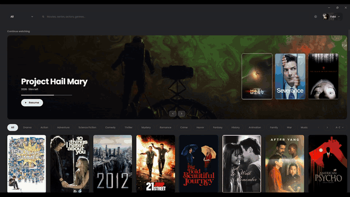

<h1 align="center">
  <br>
  <a href="https://github.com/PaulFababeir/fabiplus"></a>
  <br>
  Fabi+
  <br>
</h1>

<h4 align="center">An offline desktop library and player for your own film and show collection, built on <a href="https://electronjs.org" target="_blank">Electron</a>.</h4>

<p align="center">
  <a href="https://github.com/PaulFababeir/fabiplus/releases/latest">
    
  </a>
  <a href="https://github.com/PaulFababeir/fabiplus/releases">
    
  </a>
  
  <a href="LICENSE">
    
  </a>
</p>

<p align="center">
  
  
  
  
  
  <a href="https://www.themoviedb.org/">
    
  </a>
</p>

<p align="center">
  <a href="#key-features">Key Features</a> •
  <a href="#download">Download</a> •
  <a href="#first-run">First Run</a> •
  <a href="#where-your-data-lives">Your Data</a> •
  <a href="#building-from-source">Build</a> •
  <a href="#credits">Credits</a> •
  <a href="#license">License</a>
</p>

<p align="center">
  
</p>

## Key Features

* **Offline by design** — no account, no cloud, no telemetry
  - The only network call is TMDB metadata enrichment, and everything it returns
    is cached to disk, so the app runs with the network off.
* **Scans what you already have**
  - Release-tagged folder names are parsed for title and year, so most
    collections work as they are. Nothing is moved, renamed, or modified.
* **Films and shows alike**
  - Seasons read from the folder tree, per-episode resume, next-episode
    autoplay, and episode stills.
* **Up to five profiles**
  - Each with its own watch history, poster and backdrop picks, and image avatar.
* **Continue Watching**
  - Films and part-watched episodes together, with a right-click to mark watched
    or remove the entry.
* **A real player**
  - Seek with hover scrub preview, ±10s, speed, brightness, embedded and
    external subtitles with `V` to cycle, and an episode drawer in the controls.
* **Subtitle search and download**
  - Finds releases matching the file on disk, not just the title, so an extended
    cut does not drift out of sync. The `.srt` lands beside the video, so it
    works in every other player too.
* **Discord Rich Presence** — opt-in, one toggle, nothing to register
  - Talks to the local Discord client over its named pipe and never contacts
    Discord's servers.
* **Updates are manual**
  - Checked from Settings when you ask. Nothing phones home on launch.

> **Note**
> Windows only for now. Nothing in the code is Windows-specific except the
> installer and the Discord named-pipe path, but it has not been tried elsewhere.

## Download

You can [download](https://github.com/PaulFababeir/fabiplus/releases/latest) the
latest installable version of Fabi+ for Windows 10/11, 64-bit. One file:

```
movie-app-<version>-setup.exe
```

That is the whole app — Electron, the fonts and every dependency are bundled, so
there is nothing else to install. No Node, no npm, no cloning the source.

Ignore the other two files on a release. `latest.yml` and the `.blockmap` are
what the in-app updater reads; downloading them by hand does nothing.

It installs per-user, so there is no UAC prompt. The build is unsigned, so
SmartScreen will warn the first time — **More info → Run anyway**.

### What you supply

The app ships no films and no API key of its own:

- **Your films**, in a folder you point it at on first run.
- **A free [TMDB API key](https://www.themoviedb.org/settings/api)** for posters
  and metadata. Optional — without one the library still scans and plays, it
  just shows titles parsed from the folder names instead of artwork.

Discord Rich Presence needs nothing at all: one toggle in Settings, off by
default.

## First Run

1. **Settings → Movie folders → Add folder…** and choose the folder holding your
   films. Each film should be in its own subfolder:

   ```
   D:/Movies/
     Interstellar (2014) [1080p] [BluRay] [YTS.MX]/
       Interstellar.2014.1080p.BluRay.x264.mp4
       Interstellar.srt
     Solanin (2010) [1080p]/
       ...
   ```

   Release-tagged folder names are parsed for the title and year, so most
   collections work as-is. Films are scanned as soon as a folder is added.

   Shows have their own list in the same panel — one subfolder per show, with a
   folder per season inside it. Episode numbers are read from the filenames, and
   a folder that is not a numbered season (an "Unaired Pilot", say) is kept and
   shown as it is rather than dropped.

2. **Settings → TMDB API key.** Metadata and artwork need a free key from
   [themoviedb.org](https://www.themoviedb.org/settings/api) — either a v3 API
   key or a v4 read token. Without one the library still scans and plays; it
   just shows parsed filenames instead of posters.

3. **Settings → Fetch metadata.** Matching is fuzzy and weighted by year. Any
   film it is unsure about is listed for you to confirm, and you can re-match a
   title by hand at any time.

## Where Your Data Lives

`%APPDATA%/movie-app/`

| File | Contents | Regenerable? |
|---|---|---|
| `library.json` | Catalog and scraped metadata | Yes — rescan and refetch |
| `library.backup.json` | Snapshot taken after each enrichment | — |
| `profiles.json` | Profile list (max 5) | **No** |
| `profiles/<id>.json` | Watch progress, poster and backdrop picks | **No** |
| `config.json` | Folders, TMDB key, preferences | Yes |
| `cache/images/` | Posters, backdrops, episode stills | Yes |
| `cache/avatars/` | Profile pictures you chose | **No** |

The split is deliberate: a corrupt catalog or a full rescan can never touch your
watch history. Every write goes to a temp file and is renamed into place.

Your films are never moved, renamed, or modified. The app only reads them.

The one thing it writes into your library is a subtitle you asked it to
download: the `.srt` lands next to the video it belongs to, named after it, so
it works in any other player too. Nothing else is ever written there, and
nothing is downloaded unless you press the button.

## Discord Rich Presence

Off by default. Flip the toggle in Settings — there is nothing to register or
paste in.

While a film is playing your profile reads *Watching &lt;title&gt;* with the
poster and a countdown; paused and browsing states are shown too. It talks to
the local Discord client over its named pipe and never contacts Discord's
servers. If Discord is not running, presence simply stays off.

## Building From Source

To clone and run this application, you'll need [Git](https://git-scm.com) and
[Node.js](https://nodejs.org/en/download/) 20 or newer installed on your
computer. From your command line:

```bash
# Clone this repository
$ git clone https://github.com/PaulFababeir/fabiplus

# Go into the repository
$ cd movie-app

# Install dependencies
$ npm install

# Run the app
$ npm run dev
```

Other scripts worth knowing:

```bash
$ npm test           # 323 tests, node:test via tsx
$ npm run typecheck  # tsc --build
$ npm run dist       # NSIS installer into release/
```

> **Note**
> Only one instance runs at a time — launching a second focuses the first, which
> can look like nothing happened.

### Cutting a release

```bash
$ npm version patch      # bumps package.json, commits, creates the tag
$ git push --follow-tags
```

That tag triggers `.github/workflows/release.yml`, which builds on Windows and
uploads the installer and update feed to a **draft** release. Publish the draft
on GitHub to make it downloadable and visible to the in-app updater.

## Known Gaps

- **AC-3, E-AC-3, DTS and TrueHD audio must be converted before it plays.** It
  happens automatically on first play, with the video stream copied bit-for-bit
  — around three minutes for a 50-minute DDP5.1 episode, then cached. While one
  episode plays the next is converted in the background, so only the first file
  of a session ever waits. The Matroska container and HEVC video both play
  natively; the audio codec is the whole problem.
- **The grid is not virtualized.** Fine at a few hundred films, not at thousands.
- **An animated avatar is stored uncompressed.** Still images are re-encoded down
  to a few tens of KB; a GIF is kept whole, because decoding one returns only its
  first frame.

## Credits

This software uses the following open source packages:

- [Electron](https://electronjs.org)
- [React](https://react.dev)
- [Vite](https://vitejs.dev) / [electron-vite](https://electron-vite.org)
- [Motion](https://motion.dev)
- [Zustand](https://zustand-demo.pmnd.rs)
- [FFmpeg](https://ffmpeg.org) (via `ffmpeg-static`)
- [Poppins](https://fonts.google.com/specimen/Poppins), bundled under the SIL
  Open Font License

This product uses the TMDB API but is not endorsed or certified by TMDB.
Metadata and artwork come from [TMDB](https://www.themoviedb.org/).

## License

MIT

---

> GitHub [@PaulFababeir](https://github.com/PaulFababeir) &nbsp;&middot;&nbsp;
> Built with [Electron](https://electronjs.org) &nbsp;&middot;&nbsp;
> Metadata by [TMDB](https://www.themoviedb.org/)
